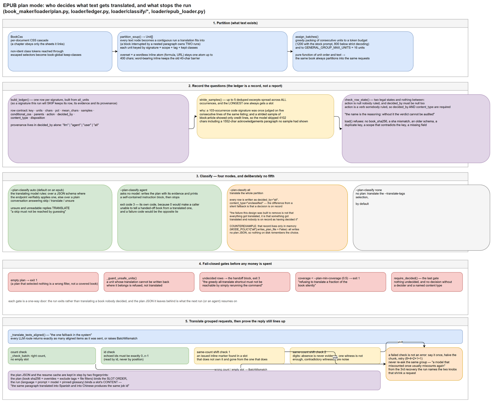
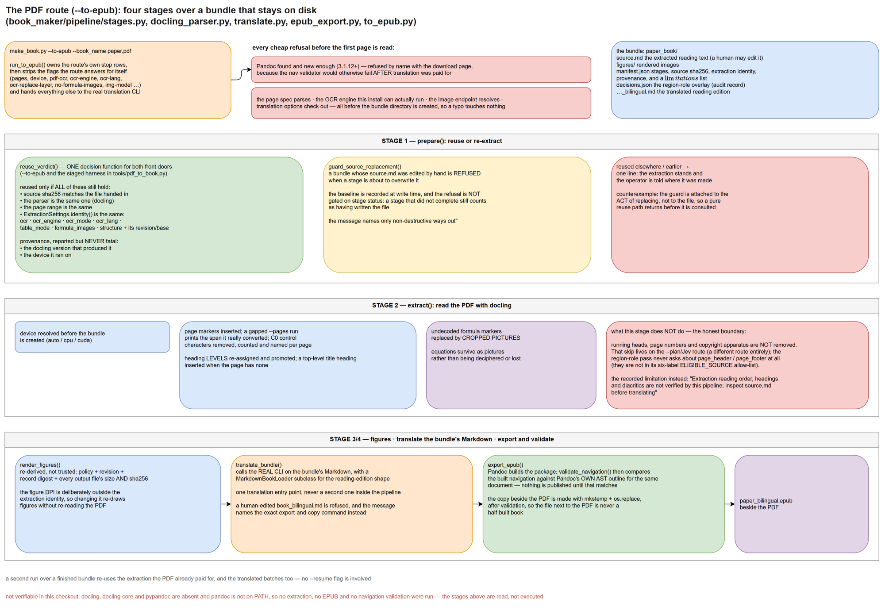
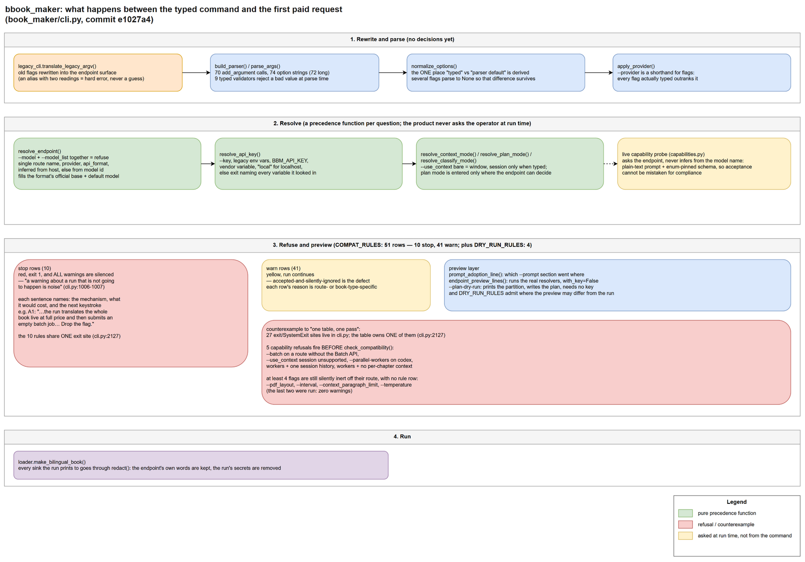

# bilingual_book_maker：当前实现体现的产品与技术设计哲学

**研究对象**：`E:\File\self\github\bilingual_book_maker`
**代码版本**：commit `e1027a4823e98f668ef950740b6f805ec30bd3b2`（2026-09-30，`feat(docs): Integrate Jev through cloudflare ai gateway as epub tag classifier (#580)`），工作树干净
**研究时间**：2026-10-16
**研究环境**：Windows，Python 3.12.3，pytest 7.4.3，项目未 pip 安装，从仓库根目录运行

本文只描述当前实现能够直接验证的事实。凡属推断、无法区分多种解释、或本环境无法运行的，都在文中和 §6 明确标注。所有源码引用都对应上面这个 commit；行号来自该版本。

---

## 1. 这个项目是什么，以及需要先记住的几个概念

### 1.1 核心问题

它把一本电子书翻译成**双语版**：原文的每一段后面跟上它的译文，仍然是一本能读的书。输入是 EPUB、PDF、TXT、Markdown 或 SRT；输出是同名的 `_bilingual` 文件，放在原文件旁边（`docs/en/index.md:3`；`docs/en/quickstart.md:47,59,62,85`）。

只有一个可执行入口：`bbook_maker`（`pyproject.toml:72`），或者从 checkout 里跑 `python make_book.py`（`make_book.py` 共 4 行，转调 `book_maker.cli:main`）。**没有任何交互式输入**——对整个 `book_maker/` 包搜索 `input(` 与 `sys.stdin` 无命中。使用者用参数、环境变量或配置文件表达全部意图。

### 1.2 四个必须先理解的概念

| 概念 | 它是什么 | 为什么重要 |
|---|---|---|
| **route（路由）** | 按"端点说的是哪种线上格式"选择翻译实现，而不是按模型名字。`openai`、`anthropic`、`codex`、`gemini`、`qwen`、`groq`、`xai`、`litellm` 是 LLM 路由；`google`、`deepl`、`caiyun`、`tencent`、`customapi` 是固定引擎的机器翻译服务。映射表见 `book_maker/translator/__init__.py:22-54` | 一个模型名（如 `gpt-6-luna`）不能告诉你服务端是否真的应用了 JSON Schema、是否接受某个参数、是否提供这个模型。项目因此把"格式"和"模型"分开 |
| **unit（单元）与 signature（签名）** | unit 是一段能独立放置译文的连续文本（一个被嵌套段落打断的块会拥有两个 unit）；signature 是 `scope + 标签 + 保留的 class`，例如 `block:p.note` 或 `inline:span.line-no`（`book_maker/loader/plan.py:1069-1106`，`loader/ledger.py:16-31`） | 它们是把"整本书"压缩成"几十个可判定的问题"的中间层 |
| **plan（计划）文件** | `<book>_plan.json`。每一行是一个 signature 加它的证据（出现次数、字符占比、最多 5 条抽样）和它的判决（`action` / `decided_by` / `content_type`）。它是这个工具唯一要求人或 agent 手工编辑的文件（`loader/ledger.py:1-37`） | plan 模式的核心产品机制，见 §3.2 |
| **plan mode / 计划模式** | EPUB 在 LLM 路由上默认开启：先分割全书、把 signature 交给模型判定哪些值得翻译，再按判定结果翻译（`docs/en/features/plan-mode.md:5,7`；`cli.py:3653-3683`） | 它决定了"书里哪些文字会被翻译"——也就是成品与原文的差异边界 |

### 1.3 「模式」不止一个

`--use_context`（窗口 / session 会话）、`--plan-classify`（all / model / agent / none）、`--api_format`（14 种路由）三者正交，且互相有硬约束。理解项目的关键不在于记住 72 个长选项，而在于理解它**在什么情况下拒绝运行**（§3.1）。

---

## 2. 关键场景

我选了三个场景。它们的选取理由：场景 A 是绝大多数使用者走的路径（EPUB + 默认设置），并且把 plan、ledger、分类、分组、对齐校验、断点续传串在一起；场景 B 是唯一把"昂贵且不可复现的外部处理"变成产品概念（bundle）的路径；C 是贯穿所有路径的决策模型——它决定使用者能看到什么、以及什么时候会被直接拒绝。

### 场景 A：翻译一本 EPUB（默认路径）

命令就是文档首页那一行（`docs/en/index.md:8`）：

```bash
bbook_maker --book_name my_book.epub --use_context session
```

**我在本环境实际执行过的等价操作**（无网络、无真实密钥）：

```
$ python make_book.py --book_name test_books/animal_farm.epub --plan-dry-run
plan grouping: budget 1200 tokens per request on a schema-verified endpoint,
800 below strict decoding (derived; --accumulated_num overrides)
Translation plan: 20 documents, 202560 chars, coverage 100.0%
signature                               units     chars      %  sample
block:p.calibre_13                        285    188081   92.9  Any fairminded ...
block:p.calibre_10                         12      5035    2.5  This book was ...
inline:span.calibre7                       42      1142    0.6  R.
...
skipped characters: excluded-tag=3
batches: 402 unit(s) in 51 request(s) (<= 16 units / 1200 tokens per request)
plan written to test_books/animal_farm_plan.json — every row is a question: ...
```

执行过程（图 2 是这一节的全景，下面按编号对应）：



1. **解析与归一（`cli.py:2989-2999`）**。旧参数形式先被重写（`legacy_cli.translate_legacy_argv`），再进入 argparse。`normalize_options()` 是唯一区分"使用者输入过" 与 "argparse 默认值" 的地方（`cli.py:1977-2021`）；若干参数故意解析成 `None` 就是为了保住这个区别。
2. **解析路由与模式（`cli.py:3161-3270`）**。`resolve_endpoint`、`resolve_api_key`、`resolve_context_mode`、`resolve_plan_mode`、`resolve_classify_mode` 依次确定这次运行到底是什么。
3. **拒绝/告警检查（`cli.py:3270`）**。`COMPAT_RULES` 的 51 行检查同时决定这次命令能否继续。
4. **分割全书（`plan.py:1235-1249`，`plan.py:2178-2226`）**。每个文档被解析成 soup，按每章的 CSS 层叠（`BookCss`，`plan.py:2101-2158`）判断块级/行内，再切成 unit。此步是纯函数：它只依赖书的内容与设置。
5. **建立 ledger（`plan.py:1847-1924`）**。每个 signature 一行，携带证据。我实测同一本书连续两次 `--plan-dry-run` 产出的 JSON 文件 SHA256 完全相同（`7BAAFFC7…836`），也就是**分割与分组是可复现的**。
6. **分类**。`auto` 模式下由翻译模型裁决：端点可验证严格 JSON Schema 时走结构化输出，否则走普通会话逐轮问答（`book_maker/loader/classify/__init__.py:104-119`）。我实测 `--plan-classify agent`（不问任何模型）在干净书上是 31 个待决行，输出一份完整交接指令后以退出码 **3** 结束。
7. **门禁**。空计划、无法写回的 unit、未决行、覆盖率低于 `--plan-min-coverage`（默认 0.5）都会让运行以错误结束（`epub_loader.py:1508-1517`、`1739-1767`、`1701-1736`）。
8. **翻译**。按 plan 的分组发请求；每个分组的回复必须"数量正好、槽位正确"，否则进入对半切分重试的梯子（`epub_loader.py:2356-2438`）。
9. **写回与落盘**。plan JSON 原子写入（临时文件 + `os.replace`，`ledger.py:402-422`）；进度写 `.{stem}.temp.bin`，崩溃后可用 `--resume` 续（`epub_loader.py:4214-4239`）。

**我另做的两个行为验证**：

- 我手工把 plan 中前 3 行的 `action` 改成 `translate`、`decided_by` 改成 `user`、`content_type` 改成 `prose`，重跑 `--plan-classify agent`：输出 `using existing plan …`，交接提示变成"还有 28 行未决"，退出码仍为 3。**使用者手改的行被保留，没有被重新提问**。
- 我把第 4 行改成 `action: "translate"` 但 `decided_by: null`，同样的命令直接拒绝：
  ```
  test_books/animal_farm_plan.json carries 1 invalid row(s):
    block:blockquote.calibre_17: action is "translate" with decided_by null.
  Every decision has to name who made it: set decided_by to one of agent, all, llm, user ...
  Fix them in that file, or delete it and rerun to regenerate a fresh plan.
  ```

### 场景 B：把一个 PDF 变成双语 EPUB（`--to-epub`）

```bash
python make_book.py --book_name paper.pdf --to-epub --pages 1-2 --test   # 先读两页
python make_book.py --book_name paper.pdf --to-epub --use_context session # 再跑全书
```

执行过程（图 3 是这条路由的全景）：



1. `cli.main` 在这里**改道**，进入 `run_to_epub`，而不走普通 PDF loader（`cli.py:3023-3037`）。参数先被分成"这条路由自己回答的"和"交给内层翻译 CLI 的"两类（`pipeline/to_epub.py:46-94`）。
2. 所有便宜的拒绝先跑完：Pandoc 是否存在且版本够（`3.1.12+`，否则按名字带下载页拒绝，`tests/test_pandoc_version.py`）、页码格式、本机能否运行所要求的 OCR 引擎、图像端点、翻译参数——都在 `bundle.create` 之前（`to_epub.py:171-195`）。
3. `prepare()` 决定"复用还是重新抽取"（`pipeline/stages.py:242-324`）。判据是一个显式的**身份/溯源分离**：只有决定文本内容的设置（OCR 开关、引擎、语言、表格模式、公式图、结构判定及其版本）参与身份比较；docling 版本与设备只是溯源，会打印一行但**不会**让抽取失效（`stages.py:168-192`、`216-229`）。
4. 抽取：用 docling 读 PDF，插入页码标记、清理 C0 控制字符、重新分级标题、把未解码的公式标记换成裁剪出的图片（`docling_parser.py`）。产物是 bundle 目录里的 `source.md` 与 `manifest.json`。
5. 图像、翻译、导出：`translate_bundle()` 调用**真正的 CLI** 翻译 bundle 里的 Markdown；`export_epub()` 用 Pandoc 打包，然后 `validate_navigation()` 把生成的导航与 Pandoc 自己对该文档的 AST 大纲对照，只有通过才发布（`epub_nav.py:190-229`、`epub_export.py:138-148`）。
6. 复制到 PDF 旁边用 `mkstemp` + `os.replace`，因此 PDF 旁那个文件永远不会是半个成品（`to_epub.py:246-258`）。

**重要更正**：这条路由**并不**删除页眉、页码或版权页。抽取阶段对文本的全部改写只有页码标记、控制字符、标题层级、公式图、以及缺少顶层标题时插入一个标题（`docling_parser.py:1195-1247`）。"跳过页眉页码"属于另一条路由（`--plan` + 分类器，`cli.py:778-781`）；区域角色判定**只处理六种白名单标签**（`text`、`paragraph`、`footnote`、`caption`、`section_header`、`title`，`decisions.py:81-88`），`page_header`/`page_footer` 在该模块中只作为 overlay 的取色项出现（`decisions.py:139-140`），因此从来不是被判定的对象。这条路由对使用者的诚实交代是一条记录下来的 limitation："抽取的阅读顺序、标题与变音符号不由本管线验证；翻译前请检查 source.md"（`docling_parser.py:1313-1316`）。

**验证限制**：本环境没有安装 `docling` / `docling-core` / `pypandoc`，`pandoc` 也不在 PATH，因此我**没有真正跑过抽取、EPUB 生成或导航校验**。这一场景的机制部分因此是**纯静态阅读**。该路由可离线运行的测试模块（`test_pdf_headings`、`test_pdf_figures`、`test_pdf_formula`、`test_pdf_settings`、`test_pdf_render`、`test_pdf_ocr_replace_layer`、`test_pdf_structure_wiring`、`test_epub_nav`、`test_pdf_to_epub_cli`、`test_bundle_pipeline`、`test_pdf_source_edit_guard`）我都跑过并通过，但其中依赖 Pandoc 的部分被跳过：例如 `test_bundle_pipeline.py` + `test_pdf_source_edit_guard.py` 合计只有 **18 passed / 70 skipped**（后者 22 个测试全部因缺 pandoc 跳过）。`tests/test_pdf_decisions.py` 的 31 个测试在模块级 `importorskip` 处整体跳过。**不要把这几个模块的"通过"读成 PDF 路由已被验证**。

### 场景 C：一条出错的命令行

```bash
$ python make_book.py --book_name test_books/animal_farm.epub --api_format groq --key sk-test --model m --batch
Error: --batch / --batch-use are broken on epub: queueing lives on a path the epub
loader never takes, so the run translates the whole book live at full price and
then submits an empty batch job — and --batch never writes the book at all. Drop the flag.
```

退出码 1，且**所有告警都被抑制**——两处注释分别把理由写成了原则：`cli.py:1006-1007` 是"when any fires, only the stops are printed, because a warning about a run that is not going to happen is noise"，`cli.py:2122-2127` 是"the run is over, and advice about a run that is not going to happen is noise in front of the reason it isn't"（后者同时是**表内唯一的退出点**，10 条 stop 规则共用它）。

这条路径的产品含义在 §3.1 展开。这里只需注意：这句话同时给出了**机制**（排队代码在 epub loader 永远不走的分支上）、**代价**（整本书按原价实时翻译，然后提交一个空批处理任务）、以及**下一步动作**（Drop the flag）——而且这些是 51 条规则里每一条的写法。

---

## 3. 产品设计哲学

以下原则按"最能解释整体体验"排序。每条给出：具体表现 → 解决的问题 → 证据 → 代价 → 反例与适用范围。

### 3.1 「会被静默忽略的输入」被当作缺陷：51 条规则的单表拒绝与告警

**表现**。`cli.py` 里有一张 `COMPAT_RULES` 表，51 行：10 行 `stop`（红字、退出码 1、抑制所有告警），41 行 `warn`（黄字、继续运行）。同一来源测得 `DRY_RUN_RULES` 另有 4 行，用于 `--plan-dry-run` 预览（`cli.py:1949-1974`）。



**解决的问题**。这个工具最贵的资源不是 CPU 而是"一本已经付过钱的书"。表中多行规则的理由正是"会付钱且做错事"：A1 的 `--batch` 在 epub 上会按原价翻译完整本书然后提交空任务；A4 的 `--parallel-workers` + `--accumulated_num>1` + `--resume` 组合"完全不记录进度"，中断后要重新付整本书；A7 的 `--model_list` + session 模式会让每一次请求都重读全部历史（`cli.py:1148-1264`）。

**证据**。规则句子的结构本身是证据：每一行都命名了机制、代价和替代动作。规则的级别是数据结构的一部分，测试强制"每条 warn 行都必须有一条会触发它的 fixture 和它会打印的短语"，并且"规则 id 唯一"（`tests/test_flag_compat.py:1289-1298`）。还有一组测试专门断言"一条普通的 epub/txt/pdf/机器翻译命令**什么都不触发**"（`TestNoiseGuard`，`tests/test_flag_compat.py:934-995`）——也就是说，拒绝是要花钱买来的，不是免费加的。

**代价**。51 条手写句子构成一个不能随意改动的对使用者接口：新增一个参数必须考虑 路由 × 书类型 × 模式 的交叉。`--help` 有 534 行、67 个长选项在一个扁平列表里，没有 argparse 分组（`cli.py:2182-2856`）。

**反例（重要）**。"一张表、一遍检查"这个说法只部分成立：`cli.py` 里有 27 处 `exit(1)` / `raise SystemExit`，其中**表自身只有 1 处**（`cli.py:2127`，10 条 stop 规则共用它）；其余是散布在 `main()` 里的手写拒绝，至少 5 处能力相关的拒绝在 `check_compatibility` 之前跑（`cli.py:3172-3228`）。还有至少 4 个参数在它们的路由之外**被静默接受且没有任何提示**：`--pdf_layout`（只有 PDF loader 会收到，`cli.py:3371-3372`）、`--interval`（只在 gemini 路由生效，`cli.py:3594-3595`）、`--context_paragraph_limit`（B11 行要求 `context_mode == "session"`，所以在没有 `--use_context` 时零提示，`cli.py:1361-1371`；我设 `OPENAI_API_KEY=sk-fake` 实跑 `--context_paragraph_limit 5`（不带 `--use_context`）确认零告警）、以及 `--temperature`（41 条 warn 行中没有任何一行提到它；我实跑 `--api_format google --temperature 0.1` 确认零告警、运行照常开始）。所以这张表是**有意收窄**到"依赖已解析路由或书类型的组合"，但收窄的边界没有在代码里说明，也无法从当前实现区分"原则如此"还是"历史堆积"；这一类到底有多大，没有被枚举过。

**适用边界**。表中规则 id（`A1`…`C37`）引用的审计文档（`docs/2609*-*.md`）**不在这个 checkout 里**；`A2`、`C15`、`C17` 在整个仓库中不出现。因此每条 id 背后的原始需求，公开仓库的读者无法回溯。

### 3.2 只有人能做的判断，被交出去成为一份文件契约，然后运行停下

**表现**。`--plan-classify` 有四个模式，而没有第五个。`book_maker/loader/classify/__init__.py:17-20` 把缺失的那个写作原则："There is deliberately no fourth mode where nobody rules and the code translates whatever it could not rule out — that silent default is what made a heuristic's blind spot look like a decision."

- `auto`：翻译模型裁决。端点能验证严格 schema 时一问一页；否则退化成普通会话，每轮五个 signature，答 `skip`/`translate`/`unsure`，连续两次答错格式就降为每轮三个、再降为一个，低于一个就停止分类并把剩余全部翻译（`docs/en/features/plan-mode.md:38`）。
- `agent`：不问任何模型。写出 plan 与证据，打印一份自足的指令块，然后**停下**，退出码 3。退出码是专门选定的：0 会让脚本无法区分"已交接"与"已翻译完成"，失败码则是相反方向的谎言（`book_maker/loader/classify/__init__.py:43-51`）。
- `all`：翻译整个分区——和"静默回退"结果相同，但每一行都写成 `decided_by="all"`、`content_type="unclassified"`。模块 docstring 把差别讲清楚了："the failure this design was built to remove is not 'everything got translated', it is 'something got translated and nobody is on record as having decided it'"（`book_maker/loader/classify/all.py:1-16`）。**但这份"记录"只存在于内存**：`MODE_POLICY["all"].writes_plan_file = False`，`all` 不写 plan 文件、也不读已存在的 plan（`book_maker/loader/classify/__init__.py:80-84`），而 `epub_loader.py:1643-1646` 直接跳过保存。所以 `all` 的出处记录不会被留在磁盘上——这是"有出处"原则的一个真实例外。
- `none`：不建计划，回到按标签选择。

**证据（可复现）**。见我实测的退出码 3 与交接文本（§2 场景 A）。行状态机 `check_row_state` 强制两种合法状态，中间没有第三种：`action` 为 null 时 `decided_by` 必须也为 null；`action` 是动词时 `decided_by` 与 `content_type` 都必须有。拒绝文案是一个设计声明："the name is the reasoning, and without it the verdict cannot be audited"（`ledger.py:98-164`）。`ledger.load` 还拒绝：缺 `book_sha256`、sha 不匹配、schema 版本不同、重复 key、scope 与 key 矛盾、缺字段（`ledger.py:424-530`）。

**解决的问题**。一本书里哪种标签是正文、哪种是页眉/页码/校勘符号，没有便宜的规则可以判定；错的默认会**静默地**丢弃或错译文本。把判断外化成文件后，判断可以被审查、被复用、被 diff。

**代价**。这条路径无法无人值守；使用者要么手改 JSON，要么交给 agent。plan 文件一旦存在，之后的每一次运行都会读它（除 `all` 模式外，`MODE_POLICY`，`book_maker/loader/classify/__init__.py:80-84`），使用者的编辑会成为长期事实。

**反例**。并非所有判断都被交出去：`auto` 在可探测的路由上自己裁决，`all` 用"拒绝判断"来裁决。交出去的只是四种模式之一。此外，agent 模式**不预填**任何答案——即使指定了分类器也会忽略它，理由是"an agent judges worse from pre-filled answers"（`docs/en/features/plan-mode.md:40`）。

### 3.3 先说不花钱的实话：预览与"我可能哪里说得不准"

**表现**。`--plan-dry-run` 不需要任何凭据，打印分割表、写 plan、然后返回（实测输出见 §2 场景 A）。运行开始前还会打印：`prompt_adoption_line`（每个 `--prompt` 段落被采用到哪、落到 system 还是 user，`cli.py:591-631`）、`endpoint_preview_lines`（用真正的解析函数、`with_key=False`）、`Glossary: N pinned terms loaded`、以及每个被弃用参数被重写成了什么。

**证据**。预览不是承诺，而是"加上它的不确定度一起说"：`DRY_RUN_RULES` 里 B3 明确告知真实运行可能发出**更多**请求（`cli.py:1956-1966`）；B2 用 `dry_run_plan_divergence` 列出两种"真实运行可能根本不在计划模式"的情况，其 docstring 还记下预览曾经预测过一个没人会跑的运行（`cli.py:1891-1909`）；测试钉住预览与 `resolve_plan_mode` 答案的一致性（`tests/test_flag_compat.py:1518-1541`）。

**代价**。这是第二条必须与主路径保持镜像的代码路径，需要专门的测试来保证它不漂移。而镜像必然有猜的地方：dry run 没有翻译器可以测量 prompt 开销，所以它按"库存 prompt"估算并**把这件事打印出来**（`cli.py:3083-3095`）。

**范围**。这条原则是关于**告知**的，不是关于**门禁**的。同一份代码里也有明确不判断的地方：`UsageMeter` 的注释说用量"显示在进度条上而不是被评判：这个比例值不值是操作者的判断"（`base_translator.py:152-156`）。

### 3.4 用户可见的文字是被测试的产物，一句话只有一个出处

**表现**。三组机制：

1. `tests/test_cli_documentation.py` 用 AST 从 `book_maker/cli.py` 读出所有长选项，**双向**校验：全部 67 个必须出现在 `README.md`、`README-CN.md`、`docs/en/cmd.md` 中；反之，包括 `.agents/skills/bbm-plan/SKILL.md` 在内的 18 个参考文件不得出现 CLI 没有的参数（`tests/test_cli_documentation.py:69-75`、`121-188`）。
2. 模型的 prompt 被逐字钉住：`tests/test_prompts_documented.py` 要求每个发给模型的 prompt 是测试里的字面量、并且已退役的六种措辞不得存在于包内任何位置；文件开头写着"Revising a prompt is meant to update this file in the same commit — that is the point, not friction to route around"。
3. 同一条文案只有一个对象：`OCR_REPLACE_NEEDS_OCR` 同时被 `cli.py:1224` 的规则行和 `pipeline/stages.py:92` 的管线异常使用——使用者在 PDF 路由开始前读到的句子，与管线内部会抛出的句子是同一个字符串。

**解决的问题**。这个工具有两类读者：一个人，和一个照着 skill 文件操作的编码 agent。两者都会被过时参数名带向 argparse 报错。这一点在代码注释里被反复作为理由写出。

**代价**。改一个参数名或一句 prompt，必须在同一个提交里动测试与文档。参考文件清单是手工维护的（`tests/test_cli_documentation.py:121-141`），可以静默漏掉新文档。

**反例**。校验是**文本级**的：一个参考文件可以提到某个参数并把它描述错。而且"一句话只有一个出处"并不覆盖 CLI 自身：70 个 `add_argument` 中有 52 个的 `help=` 是 `build_parser` 里的内联字面量，18 个引用常量（这 70 个调用对应 67 个进入文档校验的长选项——4 个 `SUPPRESS`、1 个以 "deprecated" 开头的 help 被跳过）。对比之下 `pipeline/messages.py` 有 125 个大写常量，其 docstring 声称"这一路径上人会读到的每个字符串都在这里"。

### 3.5 输出文件里说它是机器翻译的，但不说是谁在什么机器上翻的

**表现**。EPUB 里可见的只有一小段：`Translated by gpt-6-luna, 2026.`，放在标题页，样式刻意压低（`loader/disclosure.py:1-13`、`80-91`）。**包元数据里什么都不写**：曾经的 `trl`/`bkp` 贡献者条目、`dc:description` 标记、以及所有 `bbm:` meta 都被移除，理由是它们"是关于谁造了这个文件的声明，而不是关于译文本身的声明"（`disclosure.py:14-21`）。比这条可见行更进一步，计划模式或会话模式的运行会写一份机器记录 `bbm_translation_metadata.json`；它的键集合是硬编码的四个：`generator`、`model`、`date`、词表 sha256（`translation_metadata.py:91`，测试同时钉住这个集合——"adding a fifth key is a decision somebody makes on purpose"）。明确不写的是操作者、机器、命令行、构建号（`translation_metadata.py:9-14`、`28-43`）。而上一轮的标记被**当作自己的东西处理**，不是被尊重：复制时被剥掉并按本次运行的事实重写，所以一本先由 A 模型翻译再由 B 模型翻译的书不会同时声称两者（`disclosure.py:41-44`）。

**代价与张力**。这里的取舍是显式的：**可审计性**（读者能看到译文可能哪里出了问题）优先于**可追溯性**（不会把文件追回到运行它的人）。同一个取舍也出现在凭证上：`redact()` 保留端点的原话、只删掉本次运行自己持有的密钥，因为端点的话通常是唯一能解释出了什么问题的信息（`redaction.py:1-12`）。

**未验证**。我没有真实翻译过一本书，因此没有检查过真实产物里这段可见文字与记录文件的最终形态；上面是对代码的阅读。

---

## 4. 技术设计哲学

### 4.1 决策与执行分离，决策可复现

**选择**。三个阶段被刻意分成"纯计算"与"花钱执行"：分割全书（`build_plan`/`partition_soup`，纯函数，只依赖书与设置）、产出问题清单（ledger）、再执行翻译。`assign_batches` 的 docstring 把不变量写成："A pure function of unit order and text, so the same book always partitions into the same requests"（`plan.py:1681-1682`）；`unit_tokens` 用固定的 `cl100k_base` 编码计数，理由同样是"分组必须是书的性质，而不是端点的性质"（`plan.py:1643-1654`）。

**收益**。同一本书的分组、请求数、plan 文件都可复现——我在同一本书上两次 `--plan-dry-run` 得到逐字节相同的 JSON。这也让 `--plan-dry-run` 的预测与真实运行共享同一套函数（`plan_budget_notice` 被预览和运行共用，`plan.py:1615-1640`）。

**代价**。为了让"同一个书 = 同一个分割"，任何会改变 unit 列表的改动都必须提升 `PLAN_SCHEMA_VERSION`（当前 7），而旧版本的 plan 会被拒绝而不是尽力匹配（`ledger.py:43-53`、`443-452`）。第七条注释记下了一个真实代价：一次 class 过滤的改动让某本书的 signature 从 1182 个降到两位数，因此旧 plan 必须整体作废。

### 4.2 不可复现的外部依赖：身份与溯源分离，派生品一律重算

**选择**。PDF 的抽取被建模为"身份"与"溯源"两类事实（`pipeline/pdf_settings.py:122-141`、`stages.py:168-192`）：只有决定文本的设置参与复用判定；docling 版本与设备进入 manifest 并会被打印，但不会让抽取失效。派生品（图像、EPUB）从不被信任：`pdf_figures._still_drawn` 要求策略、版本、记录摘要以及**每个**输出文件的大小和 sha256 都吻合（`pdf_figures.py:671-689`）；EPUB 总是重建。

**收益**。同一本书在同一台机器上第二次运行 `--to-epub` 不会重新抽取、也不重新计费翻译。

**代价**。身份是小的、封闭的集合，因此没有"复用抽取但换更高 DPI 重画图"之类的单一操作（图像策略刻意不在身份内，正是为了让这个组合可以工作）；同时"改了抽取设置又想保住手改的 `source.md`"是硬停，使用者只能把 bundle 移开。

**验证限制**。这部分的行为我是靠一份合成 manifest 的探针验证的（设备变化与 docling 缺失都仍然返回复用；`--pages`、`--pdf-ocr`、`--table-mode`、`--no-formula-images` 各自返回不同的拒绝理由），不是靠真实抽取。研究细节见 `research/pdf-route.md`。

### 4.3 契约放在最上层，修复只在一个地方

**选择**。每条 LLM 路由的 `translate_list` 只有两种合法结果：返回与输入**数量完全一致**且逐项对齐的列表，或者抛 `BatchMismatch`（`translator/base_translator.py:56-66`）。**修复只有一处**：loader 的对半切分梯子 `_translate_texts_aligned`（`epub_loader.py:2356-2438`），其 docstring 自称"The one fallback in the system"。它明确不重试同一个分组，理由是"a model that miscounted once usually miscounts again, and each retry re-pays the whole group"。

**证据**。`BatchMismatch` 由 3 个模块、10 处抛出；唯一捕获它并做修复的是 loader 的梯子（另有 5 处 `except BatchMismatch`，其中两个路由立刻重新抛出）。`base_translator.py:1345-1351` 还保留着一次**被移除的**路由内自修复的墓碑："a final rung that split on every non-blank line manufactured a plausible *wrong* count out of a perfectly correct multi-line reply"。

**边界（容易读错的一点）**。这条契约只覆盖**对齐**。传输故障不走这条契约：`chatgptapi_translator.py:1747-1756` 在收到非 `BatchMismatch` 的异常时会打印一行并把整批降级为逐段翻译，而逐段路径本身是无限耐心的（§4.7）。所以"唯一修复点"的准确说法是"**对齐**错误只有一个修复点"，不是"所有失败只有一个出口"。

**代价**。每次失准都要对受影响子树再付一轮请求（约 2 倍）。

**极限**。契约的强度只等于它的检查。数量正确、无空槽、但整体串位的回复对 `BatchMismatch` 是不可见的；代码把这个盲点写进了 docstring，并在 loader 里补了两个检测器（行内标记归属、数字跨槽见证），而第二个检测器带着三条反对误报的非规则："absence alone is never evidence"、"one witness is not enough"、"the witnesses must agree which way"（`epub_loader.py:2507-2545`）。这两个检测器都需要 loader 才有的 unit 信息，所以它们不在 translator 里。

### 4.4 能力靠探测，不靠推断

**选择**。`capabilities.py` 的前提写在模块 docstring 里："A model's name says nothing about whether the server behind it applies a JSON Schema, accepts an explicit temperature, or serves the model at all." 三个探测各自被设计成"接受不等于遵守"不会造成假阳性：

- schema 探测要求纯文本，而 schema 把答案钉成一个枚举值——只有服务端真的应用了 schema，那个特定答案才可能出现（`capabilities.py:76-94`）；
- 视觉探测把随机字符串渲染成图片而 prompt 里不提它（`vision.py:63-70`）；
- 模型可用性探测只读"与模型有关"的错误，普通故障保留模型交给真实请求（`capabilities.py:344-448`）。

**收益**。同一份代码可以同时面对官方端点、网关、转售商和本地服务，而不必为每种情况写分支。判定结果按用途分级：只有 `strict` 可以走 schema 翻译，而 `shape`/`json` 可以走批量（`chatgptapi_translator.py:650-679`）。

**代价**。每个模型每个问题多一次往返；整套机制是一个赌注——探测比猜错便宜。而且探测也会错：`plan.py:1466-1474` 记录了两个**探测为 `strict` 却仍然出错**的样本，这正是"低于严格解码时预算减半"存在的原因——它是余量，不是门。

### 4.5 数字分为"测出来的"和"选的"，选的数字连同理由一起写在旁边

**选择**。操作者可调的关键常量在代码里被显式标注来源。对整个包做不分大小写的关键词统计（`book_maker/**/*.py`）：`measured` 出现 99 次（分布在 97 行），`chosen` 出现 47 次（46 行），`owner ruling` 30 处、`lead ruling` 8 处（分布在 15 个文件）；源码注释里嵌有 20 个不同日期戳（`260807`…`260929`）。最典型的是会话压缩预算：`session_context.py:76-116` 列出实测数字（4096 → 63 请求 / 36.1 万 token / 19 次压缩；8192 → 52 请求 / 39.6 万 token / 9 次压缩），然后写下"the honest record is that it did not work as intended"，仍然保留 8192，理由是连续性而非价格。

**证据（外部可见的部分）**。同一批数字有面向读者的版本，放在 `docs/en/evaluation/` 下，每页写成一篇测量报告：Abstract、Setup（日期、样本量、机型、判据）、Results 表格、Decision、Limits。分组尺寸那页的 Abstract 直接写："**These defaults are an owner-set safety margin, not a measured optimum.** The measurements say larger requests are cheaper per translated word; the owner chose margin over that saving."（`docs/en/evaluation/grouping-batch-size.md:5`）Limits 一节自己降级自己的结论（"The sweep's 'weak' model was `gpt-5.4-mini`, which is not a weak-model proxy"，同文件 `:74`）。

**收益**。一个使用者如果想把 `--max-batch-units` 从 16 调大，能在文档里读到调整的代价与"never past 48"的边界（同文件 `:70`）。

**代价与竞争解释**。注释承载的说明文字比代码多；这些数字**无法只从仓库重新推导**；改动因此被刻意造成有摩擦（"Do not move either number without re-running those two cells"，`docs/en/evaluation/session-compact-budget.md:63`）。一个必须考虑的替代解释是：这可能只是一个 AI 辅助工作流的**写作习惯**，而不是设计哲学。支持更强读法的证据是这套标注在具体地方是**承重的**——"测出来的 vs 选的"这个区分被用来论证**接受一个更差的数字**（8192 比 4096 贵），而且测量文档会专门写一节否定自己的结论。纯风格约定不需要承认发行默认值更贵。

### 4.6 状态在磁盘上，跨运行用指纹绑定

**选择**。EPUB 路径的进度写 `.{stem}.temp.bin`，其内容是"位置 + 内容 + 两个指纹"。位置由 job id 绑定（`epub:{文档序号}:{文件名}:{节点序号}:{源文本 sha256 前 16 位}`，`epub_loader.py:3138-3140`）；内容由 run 指纹绑定（语言 + 解析后的 prompt + 模型 + 钉住的词表，`epub_loader.py:1327-1365`）；plan 模式再加 plan 指纹（`PLAN_SCHEMA_VERSION` + 书的 sha256 + overrides + 排除标签 + 文件过滤，`epub_loader.py:1598-1614`）。三者不吻合就拒绝续跑，而不是续上。

**证据**。`_run_fingerprint` 的 docstring 给出了它存在的原因："the same paragraph translated into Spanish and into Chinese produces the same job id, so `--resume --language es` used to splice two languages into one book and call it finished."

**代价**。指纹不含全部参数（刻意只含"会改变已写入槽位里文字"的那些），因此改别的参数续跑是允许的；这既是特性也是需要使用者理解的地方。旧版检查点没有指纹时只打印告警并使用，理由是"拒绝它会让今天之前所有被中断的运行都搁浅"。

### 4.7 重试耐心按代码路径分级，并且每处都点出其他两处

**选择**。同一类传输故障在三条路径上有三种处置：逐段路径**无限**重试（无 `stop`，`loader/helper.py:493-505`），结构化批量路径重试 3 次（`chatgptapi_translator.py:1804-1811`），标签模式自己有一行式的逐行补救（`loader/helper.py:562-581`），而后者的注释明确写道"tag mode has no such ladder … it stays here, where the ladder cannot reach"。批量路径遇到传输故障会**降到**逐段路径，于是两种策略组合而不是冲突。

**收益**。一个使用者等待数分钟的不稳定服务不会被判死。`tests/test_translate_with_backoff.py` 把这条写成了断言（`stop is stop_never`），同时钉住"`TypeError` 永不等待"，理由是那会变成"an infinite loop rather than a failed run"。

**代价与竞争解释**。同一件事有三种实现，读者必须记住路径拓扑才知道哪一条适用。这也构成对 §4.3 的**最强竞争解释**：只读 translator 包的人会以为只有一条契约；读完 loader 与 helper 才知道是分层的。而这三者之间**没有任何机制保证同步**——只有注释和测试。

### 4.8 人编辑过的产物是交付物，系统拒绝与它竞争

**选择**。PDF 路由把"翻译前的人手编辑"当成被支持的工作流：`source.md` 可以在抽取与翻译之间被编辑，`importer.guard_source_replacement` 在**任何**改写之前检查基线，且基线是写入时记录的，**不**以阶段状态为条件（即使阶段没完成，也算"写过这个文件"）。拒绝时不改变任何东西，并给出唯一的非破坏性出路（`pipeline/importer.py:36-63`、`pipeline/messages.py:41-47`）。

**反例**。这道护栏挂在"**改写这个动作**"上，而不是挂在文件上：`stages.prepare` 在判定"可复用"时会**先返回**，护栏根本不被调用。这不是缺陷（此时文件不会被替换），但它意味着护栏不能当作"这个 bundle 被人改过吗"的查询使用，将来任何一个为别的目的写 `source.md` 的阶段都需要自己的护栏。

---

## 5. 产品与技术的对应关系

| 使用者看到的行为 | 产生它的技术机制 | 强度 |
|---|---|---|
| 一条命令不会中途停下来提问 | 包内没有 `input()`/`stdin`；每个判断都是具名优先级函数（`cli.py:366-422`、`248-274`、`836-960`） | 已验证（grep + 代码） |
| 参数组合要花错钱就根本跑不起来 | `COMPAT_RULES` 51 行，输出前检查（`cli.py:1148-2177`） | 已验证（实跑 A1 拒绝） |
| 同样的书、同样的参数，请求数与 plan 完全一致 | 分割与分组是纯函数，token 计数用固定编码（`plan.py:1604-1780`） | 已验证（两次 dry run 逐字节相同） |
| 翻译前能先看到"要翻译什么"并可以自己改 | ledger 先把全书问题落成文件，`require_decided` 在花钱前拒绝未决行（`ledger.py:368-392`） | 已验证（手改 3 行被保留；非法行被拒） |
| 交给编码 agent 后，命令以"未完成"而不是"成功"结束 | 专用退出码 3（`book_maker/loader/classify/__init__.py:43-51`） | 已验证（实跑 exit 3） |
| 一本书第二次处理不会重付抽取与翻译 | 身份/溯源分离 + 三指纹（`stages.py:152-192`、`epub_loader.py:1598-1614`） | 部分验证（合成 manifest 探针；无真实抽取） |
| 一本翻译了 20 分钟的书被打断，续跑不会把两种语言拼在一起 | run 指纹绑定语言/prompt/模型/词表（`epub_loader.py:1367-1400`） | 静态阅读 + 契约测试 |
| 阅读器打开的书不会出现"目录和正文对不上" | 导航与 Pandoc 自己的 AST 大纲对照，通过才发布（`epub_nav.py:190-229`） | 未验证（无 Pandoc） |
| 模型把两段译文串位时，书里不会出现占位符乱码 | 两个同数量错位检测器；检测到就进对半切分梯子（`epub_loader.py:2441-2578`） | 静态阅读 + 单测；未在真实端点上触发 |
| 使用者手改过的 Markdown 不会被覆盖 | 写入时记录基线，改写前拒绝（`importer.py:36-63`） | 已验证（探针脚本） |
| 一本书里不会同时出现两轮翻译的署名 | 上一轮的标记按所有权剥离并重写（`disclosure.py:41-44`） | 静态阅读 |

**反向的例子同样重要**——技术选择如何**限制**产品：

- 因为可选参数被表达成"路由 × 书类型 × 模式"的组合而不是能力层，拒绝逻辑被分成表内与表外两部分（§3.1 反例），新增参数的成本落在"要用几张规则行说清"上。
- 因为 plan 文件绑定 `book_sha256` 与 schema 版本，换书或换版本必须重新生成计划——这是可审计性的代价（`ledger.py:431-452`）。
- 因为 PDF 抽取身份是一组小的、封闭的设置，使用者不能在一次操作里"保留抽取、换更高 DPI 重画图但同时改 OCR 设置"。
- 因为依赖方向被刻意剪断（Markdown 导入不得因 import 而拉起 docling），`stages.PDF_PARSER` 与 `docling_parser.PARSER` 是两个字符串常量，靠一个测试保持相等（`stages.py:43`、`pdf-route` 研究笔记 C8）——这是一个**自觉接受**的 DRY 例外。

---

## 6. 反例、限制与不确定性

### 6.1 与主要结论不一致或需要打折的实现

1. **"一张表、一遍检查"不成立**（§3.1）。27 处退出点中表自身只占 1 处（`cli.py:2127`）；5 处能力拒绝在表之前；至少 4 个参数在别的路由上仍然静默无效且没有规则行（`--pdf_layout`、`--interval`、`--context_paragraph_limit`、`--temperature`，后两个我实跑确认零告警）。
2. **"路由从不自己修复坏回复"不成立**。`gemini_translator.py:449-451` 与 `:560-577` 记载并实现了一个批量的逐条降级路径。静态追踪控制流后这条分支看起来很难到达（`BatchMismatch` 会立即重抛，解析失败会被 tenacity 按 7 次重试后才重抛），但我**没有构造出能到达它的真实调用**，所以这是静态阅读，不是已证明的死代码。另有第二处**不是**对齐修复的降级被 §4.3 的措辞遮住了：`chatgptapi_translator.py:1747-1756` 在收到非 `BatchMismatch` 的异常时打印一行并把整批降级为逐段翻译，而逐段路径本身无限耐心。所以准确的界线是：**对齐错误只有 loader 的梯子一处修复**（`except BatchMismatch` 共 5 处，其中两个路由立刻重抛），**传输故障各路由都会自己降级**。无论如何，代码里**记载的意图**与"唯一修复点在 loader"这句话存在张力。
3. **Gemini 还会在构造批量前预处理负载**（过滤空白段落再按原位插入），理由是"模型会静默丢掉空段落，导致一次虚假的数量不匹配"（`gemini_translator.py:522-558`）。这是其他路由没有的、路由级的对齐适配。
4. **`base_translator.py:501-504` 的共享说明不完全准确**：它说这些辅助函数"因为 openai 与 anthropic 路由写得一模一样"才放在基类，但 `_compact_session` 与 `_session_budget` 在两个路由上**各自实现**，基类里没有定义。真正共享的是报告解析/装配与失败策略。准确说法是"一套报告模型，两种传输"。
5. **同一份代码对"记录里到底有什么"自相矛盾**。`epub_loader.py:828-832` 说机器记录回答的是 "which build, which model, which endpoint, which command"，而 `translation_metadata.py:9-14`、`28-43` 与 `RECORD_KEYS`（`translation_metadata.py:91`，只有 `generator`/`model`/`date`/词表 sha256 四个键）说明记录**只**回答模型、日期与词表，绝不写构建、端点或命令行。`book_maker/loader/disclosure.py:23-27` 与 `book_maker/loader/disclosure.py:14-21` 之间也有同类措辞落差。实现侧是 `translation_metadata.py` 的样子；这是文档性矛盾，不是行为矛盾，但它让我在 §3.5 里第一次写错了字段数。
6. **`_plan_token_budget` 一类注释里的"实测"数字无法在仓库内复核**：被引用的日期文档（`docs/2609*-*.md`、`CLAUDE.md`）不在这个 checkout 里；能交叉核对的只有 `docs/en/evaluation/` 下两篇。

### 6.2 本环境无法验证的事实

- **任何真实翻译**。没有 API 密钥，也没有对真实端点的调用。所有探测、降级梯子、会话压缩、价格统计的行为都只来自代码阅读与离线测试（其中 CLI 契约测试用一个 `sitecustomize.py` 在解释器启动时替换 `google`/`openai` 翻译器，因此除网络调用外的整条路径是真的，见 `tests/hermetic/sitecustomize.py:1-42`、`211-215`）。
- **任何真实 PDF 抽取**。`docling`/`docling-core`/`pypandoc` 不可导入，`pandoc` 不在 PATH。场景 B 的抽取、EPUB 生成、导航校验都没有执行过。
- **`--resume` 的真实续跑**。我在本环境无法在不花钱的前提下产生一个非空检查点，因此三指纹的拒绝行为来自代码与契约测试，不是我的运行结果。
- **真实使用行为**。没有任何用户研究、遥测或 issue 数据被查阅。本报告中所有"解决的问题／代价"都是从代码、注释与测试结构推断的，不是从观察到的使用者得出的。

### 6.3 测试基线的忠实记录

默认（hermetic）选择下 `python -m pytest tests/ -q`：**52 failed, 3043 passed, 333 skipped, 51 deselected, 3 xfailed**（22 分 37 秒）。这些失败**不是**实现缺陷，也不是我的运行造成的：

- 47 个是**区域设置**问题：本机 `locale.getpreferredencoding(False)` 是 `cp936`，而若干部测试用 `Path.read_text()`/`json.load(open(...))` 不带 `encoding`，于是 GBK 无法解码含 `…`、`⟦⟧`、CJK 的文件（例：`UnicodeDecodeError: 'gbk' codec can't decode byte 0xa6`；另一批是 `UnicodeEncodeError: 'gbk' codec can't encode character '\u2139'`，来自 CLI 子进程）。作为对照：`book_maker/` 内 12 处 `read_text(` **全部**显式指定了 `encoding="utf-8"`。
- 在同一台机器上设 `PYTHONUTF8=1` 重跑：我这次得到 **4 failed, 3091 passed, 333 skipped, 51 deselected, 3 xfailed**（22 分 41 秒）；独立复核者重跑同一命令得到 **3 failed, 3092 passed**（26 分 39 秒），差别正是下面那个顺序相关的用例。因此"去掉区域设置因素后只剩 3 到 4 个失败"是稳定结论，而"恰好几个"不稳定。残留失败都是测试的可移植性问题，不是产品缺陷：
  - 3 个断言硬编码 POSIX 路径 `.bbm/providers.json`（实际输出 `C:\Users\lzk\.bbm\providers.json`），见 `tests/test_provider_loader.py:155`、`tests/test_cli.py`、`tests/test_docling_adapter.py:391`（后者断言 `` 而实际是 ``）；
  - 1 个 `test_loader_compat_guards.py::test_a_test_run_is_told_classification_covers_the_whole_book` 是**顺序相关**的：该文件单独跑是 35 passed，在完整套件里失败，说明存在测试间状态污染，未进一步定位。
- 三个需要外部资源的选择被 `pyproject.toml:113` 默认排除：`corpus`（45 本书的验收门，会真的分割每本书并写 EPUB）、`live_provider`（会花真实配额）、`pdf_route_ci`（会真的跑 docling 并下载模型）。这三类我都没有运行。

因此：**"默认测试套件在本环境基本通过"是已证实的事实，但"全部通过"不是**；残留的 3–4 个失败与 333 个 skip 的边界已如实列出。

---

## 7. 证据与验证索引

### 7.1 关键源码位置

| 主题 | 位置 |
|---|---|
| CLI 参数面 | `book_maker/cli.py:2182-2856`（70 个 `add_argument`、74 个选项串、72 个长选项、67 个经 `SUPPRESS`/deprecated 过滤后进入文档校验） |
| 解析层 | `cli.py:366-422`（endpoint）、`248-274`（key）、`836-844`（context）、`874-936`（plan）、`939-960`（classify）、`1977-2021`（typed vs default） |
| 拒绝/告警表 | `cli.py:1148-2177`（51 行）、`1949-1974`（dry-run 4 行）、`2118-2137`（`check_compatibility`、`pdf_route_stops`） |
| 预览层 | `cli.py:591-631`、`1805-1888`、`1891-1974`、`3042-3154` |
| 分割与分组 | `loader/plan.py:1069-1106`（Unit）、`1235-1249`（partition_soup）、`1657-1748`（assign_batches）、`2101-2158`（BookCss）、`2178-2226`（build_plan） |
| 分隔与分组不变量 | `plan.py:1417-1548`（`SHORT_UNIT_CHARS`/`GROUP_MAX_CHARS`/`GENERAL_GROUP_MAX_UNITS`/`SESSION_BUDGET_FLOOR`/`SUBSTRICT_BUDGET_FLOOR` 五个常量）、`1604-1780`（预算推导到 `partition_file`） |
| ledger 状态机 | `loader/ledger.py:98-164`（check_row_state）、`175-205`（stride_samples）、`368-392`（require_decided）、`402-422`（原子保存）、`424-530`（load 与拒绝） |
| 四种分类模式 | `book_maker/loader/classify/__init__.py:1-138`、`book_maker/loader/classify/all.py:1-35`、`book_maker/loader/classify/agent.py:1-13` |
| 计划门禁 | `loader/epub_loader.py:1461-1737`（`_prepare_translation_plan`）、`1508-1517`、`1701-1736`、`1880-1951`（`_classify_plan`） |
| 对齐与修复 | `epub_loader.py:2356-2438`（梯子）、`2441-2505`（标记错位）、`2507-2578`（数字错位）、`2580-2590`（第三次起提示） |
| 断点续传指纹 | `epub_loader.py:1327-1365`（run）、`1367-1400`（检查）、`1598-1614`（plan）、`3138-3140`（job id）、`4104-4139`（load_state）、`4214-4239`（save_progress） |
| 披露与元数据 | `loader/disclosure.py:1-44`、`80-91`、`epub_loader.py:825-911`、`book_maker/translation_metadata.py:28-43` |
| 脱敏 | `book_maker/redaction.py:1-40` |
| 能力探测 | `translator/capabilities.py:76-94`（schema 探测）、`129-154`（错误类型分级：致命/瞬时/梯级拒绝）、`344-448`（模型可用性）、`485-513`（ledger）、`translator/vision.py:63-70` |
| 批量契约 | `translator/base_translator.py:56-66`、`1201-1232`（`_check_batch`）、`1345-1351`（被移除的自修复墓碑）、`chatgptapi_translator.py:1747-1756`（传输故障降级为逐段）、`1775-1802`（按 id 装配） |
| 重试分级 | `loader/helper.py:493-505`、`562-581`、`chatgptapi_translator.py:1804-1811`、`session_context.py:76-116` |
| PDF 阶段与复用 | `pipeline/stages.py:103-192`（复用判定）、`242-324`（prepare）、`pipeline/pdf_settings.py:122-141`（identity）、`pipeline/importer.py:36-63`（编辑护栏）、`pipeline/to_epub.py:46-94`、`171-258` |
| 导航校验 | `pipeline/epub_nav.py:190-229`、`pipeline/epub_export.py:138-148` |
| 商标注与测量文档 | `book_maker/loader/plan.py:1417-1601`、`book_maker/session_context.py:76-140`、`docs/en/evaluation/*.md` |
### 7.2 关键测试

| 契约 | 位置 |
|---|---|
| 每条 warn 行都有 fixture；规则 id 唯一；普通命令零噪音 | `tests/test_flag_compat.py:1289-1298`、`934-995` |
| argparse ↔ 文档双向一致（含 agent skill） | `tests/test_cli_documentation.py:69-75`、`121-188` |
| prompt 逐字钉住、退役措辞不得存在 | `tests/test_prompts_documented.py`、`tests/test_classify_prompt_pin.py` |
| 对半切分梯子的形状（干净的一半不重付） | `tests/test_batch_groups_and_markers.py:298-317` |
| 重试无限、`TypeError` 永不等待 | `tests/test_translate_with_backoff.py:85-86`、`148-154` |
| 并行下只探测一次 | `tests/test_capabilities.py:172-195` |
| 预览与 `resolve_plan_mode` 答案一致 | `tests/test_flag_compat.py:1518-1541` |
| 续跑指纹、`--test` 覆盖面、codex 即 session | `tests/test_loader_compat_guards.py` |
| CLI 与 loader 对 session 的判定一致 | `tests/test_flag_compat.py:1265-1281` |

### 7.3 可自行执行的复核步骤

```powershell
cd E:\File\self\github\bilingual_book_maker      # commit e1027a4823e9

# 1. 规则构成（期望：51 行；10 stop / 41 warn；4 条 dry-run 规则）
python -c "from book_maker.cli import COMPAT_RULES as C, DRY_RUN_RULES as D; import collections; print(len(C), collections.Counter(r.level for r in C)); print([r.id for r in C if r.level=='stop']); print([r.id for r in D])"

# 2. 参数面计数（期望：70 个 add_argument / 74 个选项串 / 67 个长选项进入文档校验）
python -c "import ast,pathlib,sys; sys.path.insert(0,'tests'); from test_cli_documentation import _long_cli_options; t=ast.parse(pathlib.Path('book_maker/cli.py').read_text(encoding='utf-8')); f=[n for n in ast.walk(t) if isinstance(n,ast.FunctionDef) and n.name=='build_parser'][0]; c=[n for n in ast.walk(f) if isinstance(n,ast.Call) and getattr(n.func,'attr','')=='add_argument']; s=[a.value for n in c for a in n.args if isinstance(a,ast.Constant) and isinstance(a.value,str) and a.value.startswith('-')]; print(len(c), len(s), len(_long_cli_options()))"

# 3. 计划可复现性（两次 dry run 的 JSON 应逐字节相同；跑完请删掉 gitignored 产物）
python make_book.py --book_name test_books/animal_farm.epub --plan-dry-run | Out-Null
python -c "import hashlib;print(hashlib.sha256(open('test_books/animal_farm_plan.json','rb').read()).hexdigest())"
Remove-Item test_books/animal_farm_plan.json -Force

# 4. 交接退出码（期望 exit 3，且输出中只有未决行数）
$env:OPENAI_API_KEY="sk-fake"
python make_book.py --book_name test_books/animal_farm.epub --plan-classify agent
Write-Output "exit=$LASTEXITCODE"; Remove-Item test_books/animal_farm_plan.json -Force

# 5. ledger 的行状态机（把某行 action 设为 translate 而 decided_by 留 null，应被拒绝）
python -m pytest tests/test_translation_plan.py -q -k "ledger or state"   # 注意本机 GBK 默认会误伤其中若干用例

# 6. 离线契约三件套
python -m pytest tests/test_flag_compat.py tests/test_cli_documentation.py tests/test_legacy_cli.py -q

# 7. 完整套件（本机需要 PYTHONUTF8=1 才能得到 4 个失败而非 52 个）
$env:PYTHONUTF8="1"; python -m pytest tests/ -q
```

### 7.4 配套材料

- **独立复核**：本文经由一个独立复核者检查（它不假设本文正确，只尝试证伪）。它抽查了 137 处 `file:line` 引用，126 处直接相符、7 处不一致、4 处部分支持，并对全部断言数字做了重算。发现的错误已全部修正：`cli.py` 注释引文（“advice”而非“warning”）、区域角色白名单的措辞（不是“显式排除”）、help 文本的基数（70 个调用中 52 内联 / 18 常量，而不是 67 中的 51 / 14）、“表内退出点 10 处”（实际是 1 处，10 是 stop 规则条数）、PDF 测试通过数（实测 `test_bundle_pipeline` 18 passed / 48 skipped，`test_pdf_source_edit_guard` 0 passed / 22 skipped）、“Measured 97 / CHOSEN 46 次”（实际是不分大小写的 99 / 47 次出现，97 / 46 是行数）、`PYTHONUTF8=1` 全套件基线（复核者实测 3 failed / 3092 passed，与本文的 4 / 3091 差在一个顺序相关用例），以及把"静默忽略"类写成只有 2 个参数（现补上复核者实跑确认的 `--context_paragraph_limit` 与 `--temperature`）。复核的完整清单与命令见 [`review/report-verification.md`](review/report-verification.md)。
- 研究笔记（含更细的 file:line、竞争解释与未验证清单）：[`research/cli-surface.md`](research/cli-surface.md)、[`research/translator-core.md`](research/translator-core.md)、[`research/pdf-route.md`](research/pdf-route.md)。后两份在复核后各加了一段更正说明（PDF 那份的测试通过数被推翻、translator 那份的记录字段数与"唯一回退"的范围需要收窄）。
- 图表：三张图各有一份可编辑源文件与一份 PNG 预览，都在 `design-philosophy/diagrams/` 下，主文按文件名引用：
  - [`diagrams/01-cli-resolution-and-refusals.drawio`](diagrams/01-cli-resolution-and-refusals.drawio) + `.png`
  - [`diagrams/02-epub-plan-mode-ladder.drawio`](diagrams/02-epub-plan-mode-ladder.drawio) + `.png`
  - [`diagrams/03-pdf-to-epub-stages.drawio`](diagrams/03-pdf-to-epub-stages.drawio) + `.png`

---

## 8. 结语：这个项目当前实际体现的设计哲学

**产品侧**，它的立场是：*一个使用者不该为一本已经付过钱、但结果被静默降级的书买单。* 由此派生出的三条做法在实现里到处可见——会被静默忽略的输入当作缺陷（51 条规则、10 条硬停）；只有人能做的判断外化成文件并让运行停下（plan JSON、退出码 3、未决行门禁）；在花钱之前把将要发生的事和它可能不准的地方一起说出来（dry run、adoption 行、B2/B3）。

**技术侧**，它的立场是：*把不确定的部分隔离出来，让其余部分保持可复现和可审计。* 决策与执行分离、能力靠探测而非推断、契约放在最上层而修复只在一处、不可复现的外部处理用"身份/溯源"分层、状态放磁盘并用指纹绑定、失败按路径分级。数字则一律标注是"测出来的"还是"选的"。

**两者是互相支撑的**：可复现的分割让"先说后花钱"成为可能；昂贵的单条契约让"一个地方修复"成为可能；文件和指纹让"运行可以停下再继续"成为可能——而"可以停下"正是把判断交给人或 agent 的前提。

**但它不是自洽的**，妥协和局部性同样真实：拒绝逻辑分成表内与表外两部分而没有说明边界；对齐修复在一条路由上留下了与"唯一修复点"相矛盾的记载；"实际只有一个解析器"是当前事实而不是被坚持的原则（`pdf_common.py:1-9` 反而是为第二个适配器预留的）；注释比代码多、被引用的审计文档不在公开仓库里，使相当一部分推理对读者不可复核。这些不是需要被"修正"的缺陷，而是这个项目当前实现里真实存在的形状——理解它们，比把它归纳成一句统一的架构口号更有用。
